# jplot Examples

This document showcases a visual catalog of the chart types and configurations available in **jplot**, along with their corresponding source code.


---

## Bars
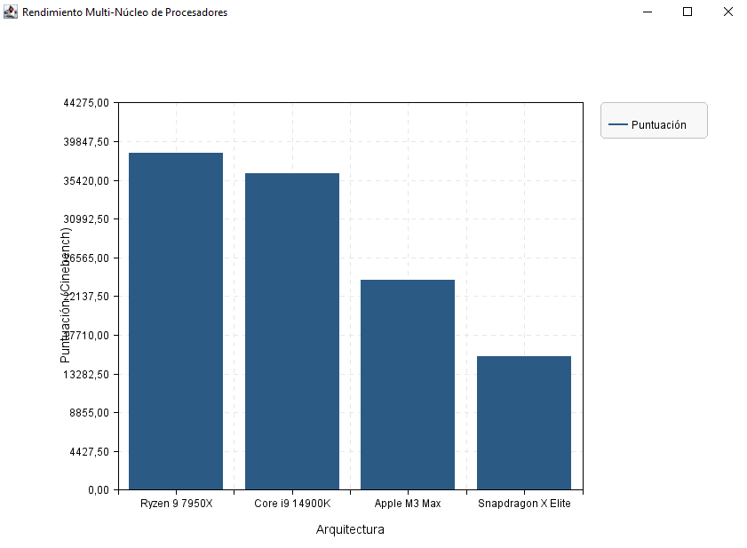

```java
package app;

import ui.Plotter;
import java.awt.Color;

public class MainBarBenchmark {
    public static void main(String[] args) {
        Plotter p = new Plotter("Rendimiento Multi-Núcleo de Procesadores", Plotter.BAR_CHART, "Arquitectura", "Puntuación (Cinebench)");
        p.grid(true, true);
        // Creamos una única serie con un azul técnico
        p.create(new Color(0x2B5B84), "name", "Puntuación", "type", "BAR");
        // Añadimos datos categóricos
        p.add("Puntuación", "Ryzen 9 7950X", 38500);
        p.add("Puntuación", "Core i9 14900K", 36200);
        p.add("Puntuación", "Apple M3 Max", 24000);
        p.add("Puntuación", "Snapdragon X Elite", 15300);
        p.plot();
        // Exportamos en Full HD
        p.img(1920, 1080, "./etc/01_bar_benchmark.png");
    }
}
```

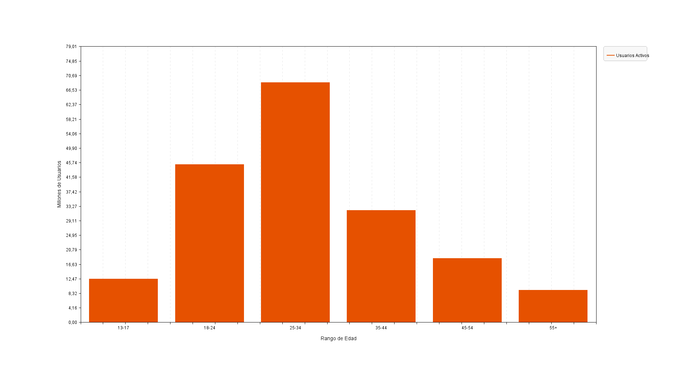

```java
package app;

import ui.Plotter;
import java.awt.Color;

public class MainBarDemographics {
    public static void main(String[] args) {

        Plotter p = new Plotter("Distribución Demográfica de Usuarios Activos", Plotter.BAR_CHART, "Rango de Edad", "Millones de Usuarios");
        p.grid(false, true); // Solo líneas horizontales para facilitar la lectura de la altura

        // Color naranja/coral
        p.create(new Color(0xE65100), "name", "Usuarios Activos", "type", "BAR");

        p.add("Usuarios Activos", "13-17", 12.5);
        p.add("Usuarios Activos", "18-24", 45.2);
        p.add("Usuarios Activos", "25-34", 68.7);
        p.add("Usuarios Activos", "35-44", 32.1);
        p.add("Usuarios Activos", "45-54", 18.4);
        p.add("Usuarios Activos", "55+", 9.3);

        p.plot();
        p.img(1920, 1080, "./etc/02_bar_demographics.png");
    }
}
```

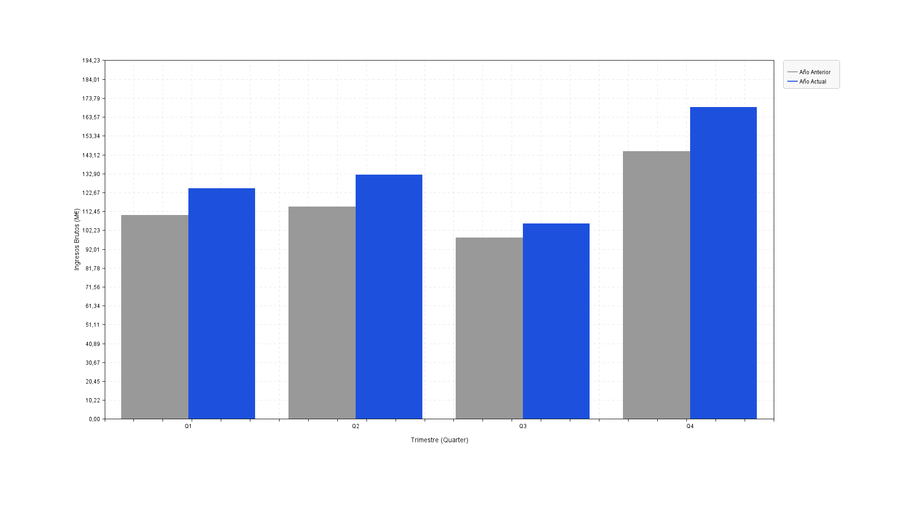

```java
package app;

import ui.Plotter;
import java.awt.Color;

public class MainBarFinancial {
    public static void main(String[] args) {

        Plotter p = new Plotter("Evolución de Ingresos Trimestrales", Plotter.BAR_CHART, "Trimestre (Quarter)", "Ingresos Brutos (M€)");
        p.grid(true, true);

        // Creamos dos series de datos para comparar
        p.create(new Color(0x999999), "name", "Año Anterior", "type", "BAR"); // Gris neutral
        p.create(new Color(0x1D51DD), "name", "Año Actual", "type", "BAR");   // Azul corporativo destacado

        // Quarter 1
        p.add("Año Anterior", "Q1", 110.5);
        p.add("Año Actual", "Q1", 125.0);

        // Quarter 2
        p.add("Año Anterior", "Q2", 115.0);
        p.add("Año Actual", "Q2", 132.4);

        // Quarter 3
        p.add("Año Anterior", "Q3", 98.2);
        p.add("Año Actual", "Q3", 105.8);

        // Quarter 4
        p.add("Año Anterior", "Q4", 145.0);
        p.add("Año Actual", "Q4", 168.9);

        p.plot();
        p.img(1920, 1080, "./etc/03_bar_financial.png");
    }
}
```

---

## Horizontal bars

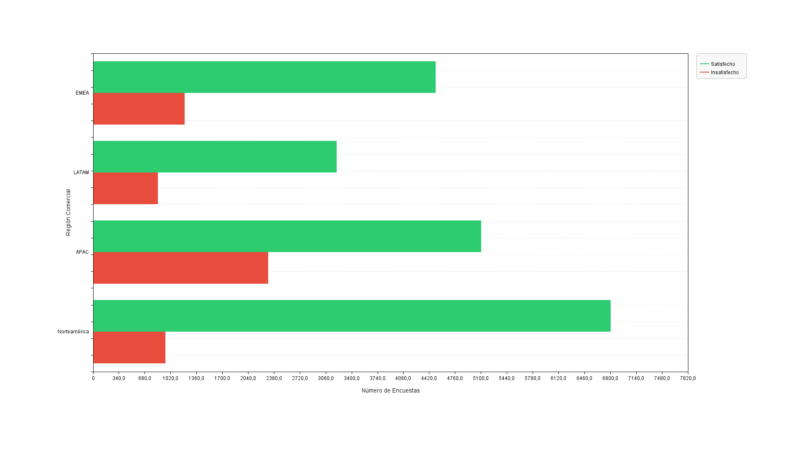

```java
package app;

import ui.Plotter;
import java.awt.Color;

public class MainHBarComparative {
    public static void main(String[] args) {

        Plotter p = new Plotter("Satisfacción del Cliente por Región Geográfica", Plotter.HBAR_CHART, "Número de Encuestas", "Región Comercial");
        p.grid(true, false);

        // Creamos dos series: Positivas y Negativas
        p.create(new Color(46, 204, 113), "name", "Satisfecho", "type", "BAR"); // Verde
        p.create(new Color(231, 76, 60), "name", "Insatisfecho", "type", "BAR"); // Rojo

        // EMEA (Europa, Oriente Medio, África)
        p.add("Satisfecho", "EMEA", 4500);
        p.add("Insatisfecho", "EMEA", 1200);

        // LATAM (Latinoamérica)
        p.add("Satisfecho", "LATAM", 3200);
        p.add("Insatisfecho", "LATAM", 850);

        // APAC (Asia-Pacífico)
        p.add("Satisfecho", "APAC", 5100);
        p.add("Insatisfecho", "APAC", 2300);

        // NA (Norteamérica)
        p.add("Satisfecho", "Norteamérica", 6800);
        p.add("Insatisfecho", "Norteamérica", 950);
        p.plot();
        p.img(1920, 1080, "./etc/11_hbar_comparative.png");
    }
}
```

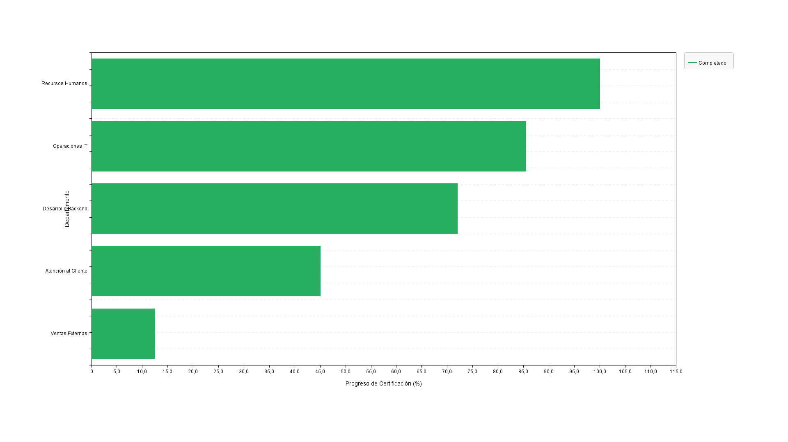

```java
package app;

import ui.Plotter;
import java.awt.Color;

public class MainHBarProgress {
    public static void main(String[] args) {

        Plotter p = new Plotter("Auditoría de Seguridad: Estado por Departamentos", Plotter.HBAR_CHART, "Progreso de Certificación (%)", "Departamento");
        p.grid(true, false);

        // Usamos un color verde (éxito/progreso)
        p.create(new Color(39, 174, 96), "name", "Completado", "type", "BAR");

        p.add("Completado", "Recursos Humanos", 100.0);
        p.add("Completado", "Operaciones IT", 85.5);
        p.add("Completado", "Desarrollo Backend", 72.0);
        p.add("Completado", "Atención al Cliente", 45.0);
        p.add("Completado", "Ventas Externas", 12.5);
        p.plot();
        p.img(1920, 1080, "./etc/10_hbar_progress.png");
    }
}
```

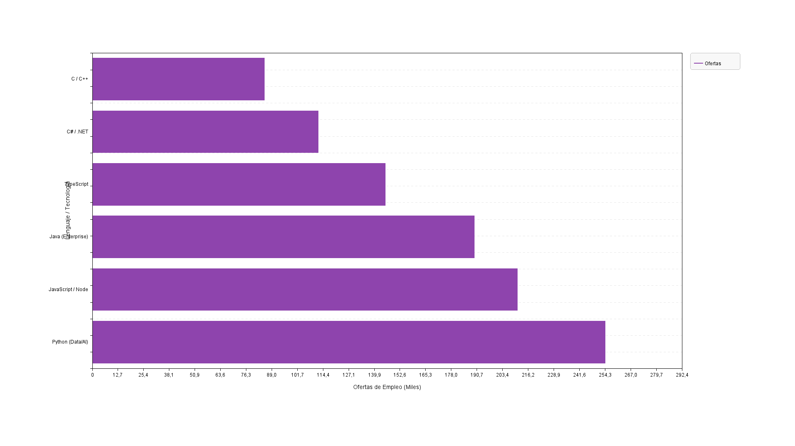

```java
package app;

import ui.Plotter;
import java.awt.Color;

public class MainHBarRanking {
    public static void main(String[] args) {

        // Fíjate que en HBAR, el Eje X es el numérico (abajo) y el Eje Y es el categórico (izquierda)
        Plotter p = new Plotter("Lenguajes de Programación Más Demandados (2024)", Plotter.HBAR_CHART, "Ofertas de Empleo (Miles)", "Lenguaje / Tecnología");
        p.grid(true, false); // Las líneas verticales ayudan a leer la longitud de la barra horizontal

        // Usamos un color morado tecnológico
        p.create(new Color(142, 68, 173), "name", "Ofertas", "type", "BAR");

        // Los añadimos ordenados de menor a mayor para que el motor los apile correctamente
        p.add("Ofertas", "C / C++", 85.4);
        p.add("Ofertas", "C# / .NET", 112.0);
        p.add("Ofertas", "TypeScript", 145.2);
        p.add("Ofertas", "Java (Enterprise)", 189.5);
        p.add("Ofertas", "JavaScript / Node", 210.8);
        p.add("Ofertas", "Python (Data/AI)", 254.3);
        p.plot();
        p.img(1920, 1080, "./etc/09_hbar_ranking.png");
    }
}
```

---

## Histogram

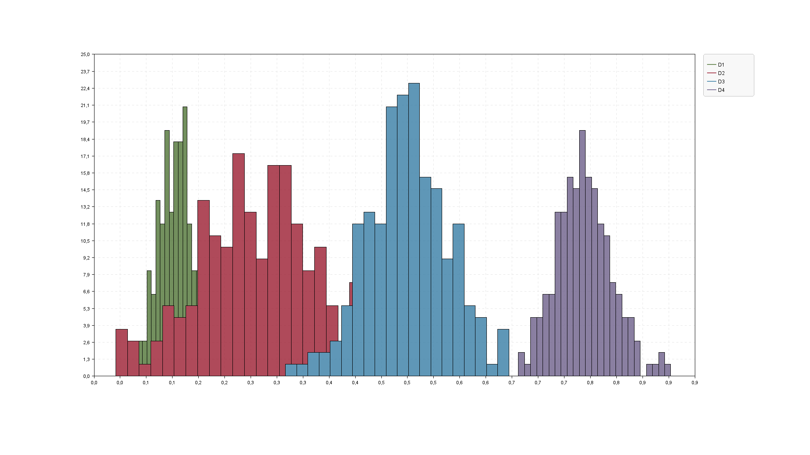

```java
package app;

import ui.Plotter;
import java.awt.Color;
import java.util.Random;

public class MainBMH {
    public static void main(String[] args) {
        // 1. Inicialización
        Plotter p = new Plotter("'bmh' style sheet", Plotter.HISTOGRAM_PLOT, "", "");

        // 2. Definición de colores con Transparencia (Alpha = 200 de 255)
        Color cGreen  = new Color(76, 114, 50, 200);
        Color cRed    = new Color(153, 24, 44, 200);
        Color cBlue   = new Color(51, 122, 163, 200);
        Color cPurple = new Color(106, 92, 135, 200);

        // 3. Creación de series ("stroke", "false" elimina los bordes negros)
        p.create(cGreen,  "name", "D1", "bins", "25", "stroke", "false");
        p.create(cRed,    "name", "D2", "bins", "25", "stroke", "false");
        p.create(cBlue,   "name", "D3", "bins", "25", "stroke", "false");
        p.create(cPurple, "name", "D4", "bins", "25", "stroke", "false");

        // 4. Inyección de datos crudos simulando las 4 campanas de Gauss
        Random rand = new Random();
        for (int i = 0; i < 200; i++) {
            // Verde: A la izquierda, muy estrecha
            p.add("D1", (rand.nextGaussian() * 0.03) + 0.1);

            // Rojo: Medio-izquierda, dispersión media
            p.add("D2", (rand.nextGaussian() * 0.1) + 0.25);

            // Azul: Centro, dispersión media-alta
            p.add("D3", (rand.nextGaussian() * 0.08) + 0.5);

            // Morado: A la derecha, estrecha
            p.add("D4", (rand.nextGaussian() * 0.05) + 0.8);
        }

        // 5. Renderizado final
        p.plot();
        p.img(1920, 1080, "./etc/03_bar_histogram.png");
        System.out.println("Histograma Multiserie Renderizado. Se debe apreciar la transparencia.");
    }
}
```

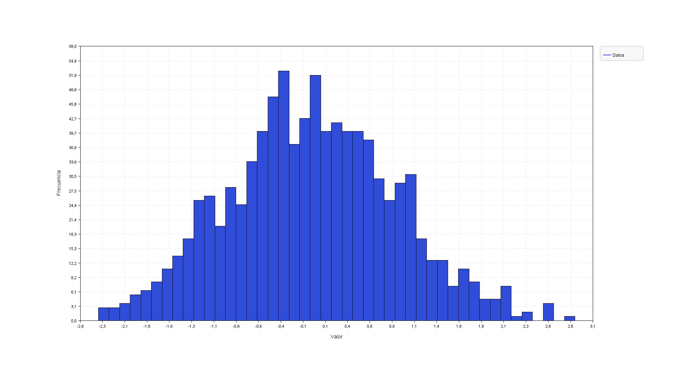

```java
package app;

import ui.Plotter;
import java.awt.Color;
import java.util.Random;

public class MainHistogram {
    public static void main(String[] args) {
        // Inicializamos la fachada
        Plotter p = new Plotter("Distribución Normal", Plotter.HISTOGRAM_PLOT, "Valor", "Frecuencia");

        // Creamos la serie especificando 45 bins (como en tu imagen)
        p.create(new Color(47, 77, 216), "name", "Datos", "bins", "45");

        // Alimentamos el motor exclusivamente con datos puros (1 dimensión).
        // El sistema calculará los intervalos y las alturas de forma invisible.
        Random rand = new Random();
        for (int i = 0; i < 1000; i++) {
            p.add("Datos", rand.nextGaussian());
        }

        p.plot();
        p.img(1920, 1080, "./etc/25_histogram.png");
    }
}
```


---

## Bubble charts

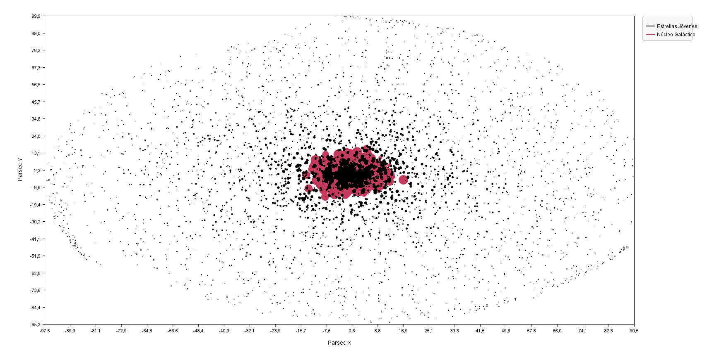

```java
package app;

import ui.Plotter;
import java.awt.Color;
import java.util.Random;

public class MainBubbleGalaxySimulation {
    public static void main(String[] args) {

        Plotter p = new Plotter("Simulación de Densidad Estelar (Formación Espiral)", Plotter.BUBBLE_CHART, "Parsec X", "Parsec Y");
        // Apagamos la cuadrícula para darle un aspecto más limpio y científico
        p.grid(false, false);

        // Un azul eléctrico muy translúcido (Alpha = 40)
        p.create(new Color(0, 0, 0, 255), "name", "Estrellas Jóvenes", "type", "BUBBLE");
        // Un naranja rojizo para el núcleo galáctico
        p.create(new Color(191, 34, 72, 226), "name", "Núcleo Galáctico", "type", "BUBBLE");

        Random rand = new Random();
        int numStars = 4000;
        int arms = 3; // Número de brazos de la galaxia

        // 1. Dibujamos los brazos espirales (Estrellas Jóvenes)
        for (int i = 0; i < numStars; i++) {
            double r = rand.nextDouble() * 100; // Distancia desde el centro
            double theta = r * 0.1 + (2 * Math.PI / arms) * rand.nextInt(arms); // Ángulo de la espiral

            // Añadimos algo de ruido (dispersión) para que no sea una línea perfecta
            double dispersion = (100 - r) * 0.05 * rand.nextGaussian();
            theta += dispersion;

            double x = r * Math.cos(theta);
            double y = r * Math.sin(theta);

            // Las estrellas lejanas son más pequeñas
            double size = 1 + rand.nextDouble() * (200 / (r + 10));

            p.add("Estrellas Jóvenes", x, y, size);
        }

        // 2. Dibujamos el núcleo superdenso en el centro
        for (int i = 0; i < 800; i++) {
            double x = rand.nextGaussian() * 5;
            double y = rand.nextGaussian() * 5;
            double size = 5 + rand.nextDouble() * 25;
            p.add("Núcleo Galáctico", x, y, size);
        }

        p.plot();
        // Exportación de la simulación
        p.img(1920, 1080, "./etc/08_bubble_galaxy_sim.png");
    }
}
```


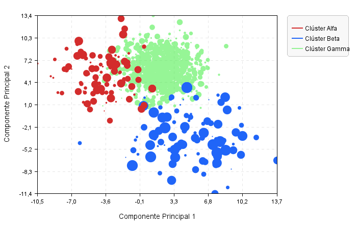

```java
package app;

import ui.Plotter;
import java.awt.Color;
import java.util.Random;

public class MainBubbleMassiveClusters {
    public static void main(String[] args) {

        Plotter p = new Plotter("Análisis de Agrupaciones (K-Means Clustering)", Plotter.BUBBLE_CHART, "Componente Principal 1", "Componente Principal 2");
        p.grid(true, true);

        // Creamos las series con una opacidad muy baja (Alpha = 60) para destacar el solapamiento
        p.create(new Color(211, 44, 44, 255), "name", "Clúster Alfa", "type", "BUBBLE");
        p.create(new Color(32, 101, 248, 255), "name", "Clúster Beta", "type", "BUBBLE");
        p.create(new Color(59, 237, 59, 136), "name", "Clúster Gamma", "type", "BUBBLE");

        Random rand = new Random();

        // Generamos 1000 puntos para el Clúster Alfa (Centroide en x:-4, y:5)
        for (int i = 0; i < 100; i++) {
            double x = -4 + (rand.nextGaussian() * 2.5); // Desviación estándar de 2.5
            double y = 5 + (rand.nextGaussian() * 2.5);
            double size = 2 + rand.nextDouble() * 15; // Tamaño aleatorio entre 2 y 17
            p.add("Clúster Alfa", x, y, size);
        }

        // Generamos 1000 puntos para el Clúster Beta (Centroide en x:5, y:-3)
        for (int i = 0; i < 100; i++) {
            double x = 5 + (rand.nextGaussian() * 3.0);
            double y = -3 + (rand.nextGaussian() * 3.0);
            double size = 2 + rand.nextDouble() * 20;
            p.add("Clúster Beta", x, y, size);
        }

        // Generamos 1000 puntos para el Clúster Gamma (Centroide en x:2, y:6)
        for (int i = 0; i < 1000; i++) {
            double x = 2 + (rand.nextGaussian() * 2.0);
            double y = 6 + (rand.nextGaussian() * 2.0);
            double size = 2 + rand.nextDouble() * 10;
            p.add("Clúster Gamma", x, y, size);
        }

        p.plot();
        // Renderizado en 4K para máxima nitidez de los millones de píxeles superpuestos
        p.img(1920, 1080, "./etc/07_bubble_clusters_massive.png");
    }
}
```

---

## Confusion matrix

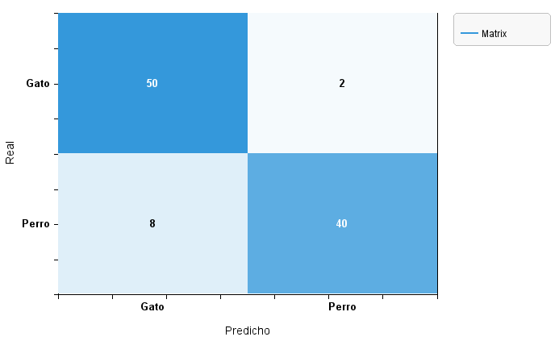

```java
package app;

import ui.Plotter;
import confusion.ConfusionDataset;
import java.awt.Color;

public class MainConfusion {
    public static void main(String[] args) {
        // Uso directo de la fachada
        Plotter p = new Plotter("Rendimiento AI", Plotter.CONFUSION_MATRIX, "Predicho", "Real");
        p.grid(false);
        p.create(new Color(52, 152, 219)); // Azul Flat

        // Añadimos datos usando el método add(String, String, double) estándar
        p.add("Gato", "Gato", 50);
        p.add("Gato", "Perro", 2);
        p.add("Perro", "Perro", 40);
        p.add("Perro", "Gato", 8);
        p.plot();
        p.img(500, 500, "etc/22_confusion_matrix.png");
    }
}
```

---

## MultiPlotter

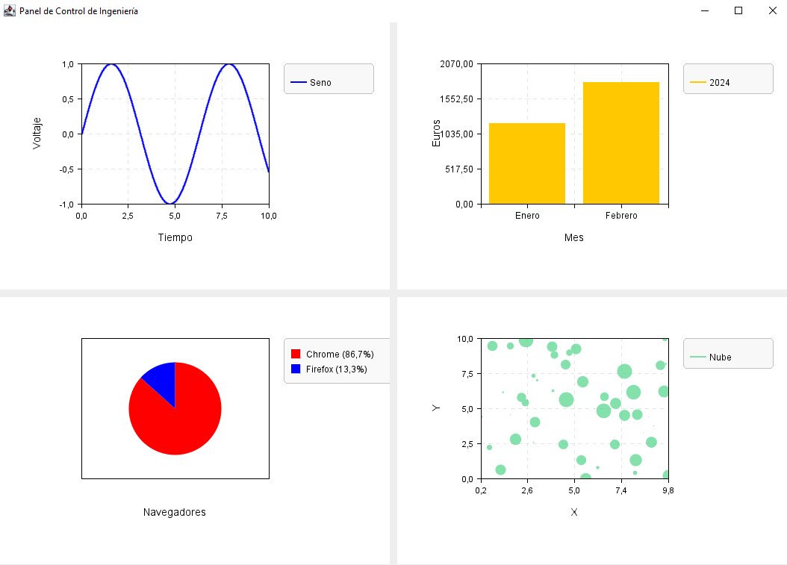

```java
package app;

import ui.Plotter;
import multi.MultiPlotter;
import java.awt.Color;

public class MainDashboard {
    public static void main(String[] args) {

        // 1. Gráfico de Líneas (Matemático)
        Plotter p1 = new Plotter("Señales", Plotter.LINE_CHART, "Tiempo", "Voltaje");
        p1.create(Color.BLUE, "name", "Seno", "type", "FUNCTION");
        p1.add("Seno", 0, 10, 500, Math::sin);

        // 2. Gráfico de Barras
        Plotter p2 = new Plotter("Ventas", Plotter.BAR_CHART, "Mes", "Euros");
        p2.create(Color.ORANGE, "name", "2024");
        p2.add("2024", "Enero", 1200);
        p2.add("2024", "Febrero", 1800);

        // 3. Gráfico de Sectores
        Plotter p3 = new Plotter("Navegadores", Plotter.PIE_CHART, "", "");
        p3.create(Color.RED, "name", "Chrome");
        p3.create(Color.BLUE, "name", "Firefox");
        p3.add("Chrome", "Global", 65);
        p3.add("Firefox", "Global", 10);

        // 4. Gráfico de Burbujas
        Plotter p4 = new Plotter("Análisis Cluster", Plotter.BUBBLE_CHART, "X", "Y");
        p4.create(new Color(46, 204, 113, 150), "name", "Nube");
        for(int i=0; i<50; i++) p4.add("Nube", Math.random()*10, Math.random()*10, Math.random()*20);

        // --- COMPOSICIÓN DEL DASHBOARD ---
        MultiPlotter dashboard = new MultiPlotter("Panel de Control de Ingeniería", 2, 2);
        dashboard.add(p1);
        dashboard.add(p2);
        dashboard.add(p3);
        dashboard.add(p4);

        // Ver en ventana y guardar en 4K
        dashboard.plot();
        dashboard.img(1080, 720, "etc/21_full_dashboard.png");
    }
}
```

---

## Heatmap

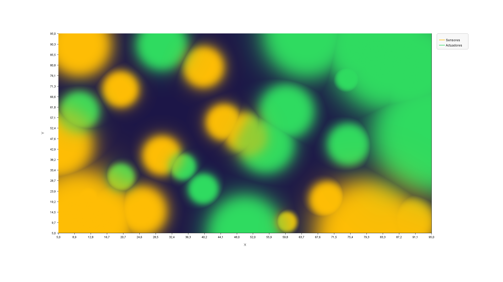

```java
package app;

import ui.Plotter;
import java.awt.*;

public class MainHeatmap {
    public static void main(String[] args) {
        Plotter p = new Plotter("Análisis Multi-Clase de Densidad", Plotter.HEATMAP, "X", "Y");

        // Configuramos el fondo morado que definimos en el Config
        // (Asumiendo que añadiste el método setBackground o lo dejaste por defecto)

        // --- SERIE 1: SENSORES (NARANJA) ---
        p.create(new Color(0xFFBE05), "name", "Sensores");

        // Clúster inferior izquierdo
        p.add("Sensores", 10, 10, 85);
        p.add("Sensores", 15, 12, 70);
        p.add("Sensores", 12, 20, 90);
        p.add("Sensores", 25, 15, 60);

        // Puntos dispersos
        p.add("Sensores", 50, 50, 95); // Gran intensidad central
        p.add("Sensores", 45, 55, 80);
        p.add("Sensores", 10, 90, 50);
        p.add("Sensores", 90, 10, 40);
        p.add("Sensores", 30, 40, 65);
        p.add("Sensores", 70, 20, 75);
        p.add("Sensores", 5, 45, 55);
        p.add("Sensores", 40, 80, 45);
        p.add("Sensores", 20, 70, 60);
        p.add("Sensores", 60, 10, 30);
        p.add("Sensores", 80, 5, 85);

        // --- SERIE 2: ACTUADORES (CIAN) ---
        p.create(new Color(0x30DC61), "name", "Actuadores");

        // Clúster superior derecho
        p.add("Actuadores", 85, 85, 90);
        p.add("Actuadores", 80, 90, 75);
        p.add("Actuadores", 90, 80, 80);
        p.add("Actuadores", 75, 75, 65);

        // Puntos de interferencia (cerca de la otra clase)
        p.add("Actuadores", 55, 45, 85); // Cerca del centro naranja
        p.add("Actuadores", 60, 60, 70);
        p.add("Actuadores", 35, 35, 50);
        p.add("Actuadores", 20, 30, 40);
        p.add("Actuadores", 95, 50, 95);
        p.add("Actuadores", 50, 5, 60);
        p.add("Actuadores", 10, 60, 45);
        p.add("Actuadores", 65, 95, 70);
        p.add("Actuadores", 40, 25, 55);
        p.add("Actuadores", 75, 45, 80);
        p.add("Actuadores", 30, 90, 40);

        p.plot();

        p.img(1920, 1080, "./etc/26_heatmap.png");
    }
}
```

---

## Line chart

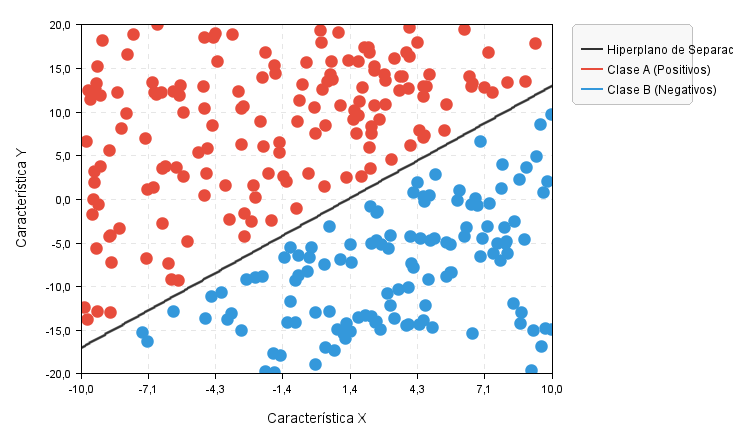

```java
package app;

import ui.Plotter;
import java.awt.Color;
import java.util.Random;

public class MainLinearClassifier {
    public static void main(String[] args) {

        Plotter p = new Plotter("Clasificador de Máquina de Soporte Vectorial (SVM)", Plotter.LINE_CHART, "Característica X", "Característica Y");
        p.grid(true, true);

        // La frontera de decisión (La línea que separa los puntos)
        p.create(new Color(50, 50, 50), "name", "Hiperplano de Separación", "type", "FUNCTION", "style", "SOLID");
        // Fórmula de la línea: y = 1.5x - 2
        p.add("Hiperplano de Separación", -10.0, 10.0, 500, x -> 1.5 * x - 2);

        // Clases de puntos (Usamos círculos)
        p.create(new Color(231, 76, 60), "name", "Clase A (Positivos)", "type", "SCATTER", "style", "POINT");  // Rojo
        p.create(new Color(52, 152, 219), "name", "Clase B (Negativos)", "type", "SCATTER", "style", "POINT"); // Azul

        Random rand = new Random(42); // Semilla fija

        // Generamos 300 puntos aleatorios y los clasificamos
        for(int i = 0; i < 300; i++) {
            double px = -10 + rand.nextDouble() * 20; // X entre -10 y 10
            double py = -20 + rand.nextDouble() * 40; // Y entre -20 y 20

            // Evaluamos el punto contra la ecuación de la recta
            double boundaryY = 1.5 * px - 2;

            // Metemos un margen (+1 / -1) para que no haya puntos justo encima de la línea (Margen del SVM)
            if (py > boundaryY + 1.5) {
                p.add("Clase A (Positivos)", px, py);
            } else if (py < boundaryY - 1.5) {
                p.add("Clase B (Negativos)", px, py);
            }
        }
        p.plot();
        p.img(1920, 1080, "./etc/14_linear_classifier.png");
    }
}
```

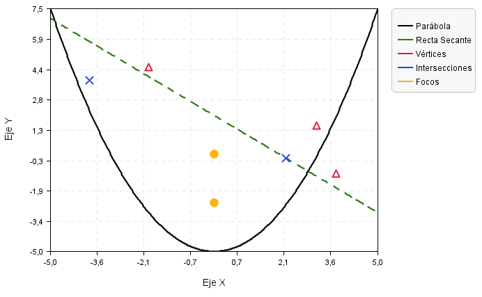

```java
package app;

import ui.Plotter;
import java.awt.Color;

public class MainMixedShapes {
    public static void main(String[] args) {

        Plotter p = new Plotter("Análisis Geométrico Multicapa", Plotter.LINE_CHART, "Eje X", "Eje Y");
        p.grid(true, true);

        // 1. Función Parabólica (Sólida)
        p.create(new Color(0, 0, 0, 255), "name", "Parábola", "type", "FUNCTION", "style", "SOLID");
        p.add("Parábola", -5.0, 5.0, 500, x -> 0.5 * Math.pow(x, 2) - 5);

        // 2. Función Lineal (Punteada)
        p.create(new Color(48, 120, 16), "name", "Recta Secante", "type", "FUNCTION", "style", "DASHED");
        p.add("Recta Secante", -5.0, 5.0, 200, x -> -x + 2);

        // 3. Puntos Sueltos: TRIÁNGULOS (Usamos type "SCATTER" para que no los una con líneas)
        p.create(new Color(220, 29, 58), "name", "Vértices", "type", "SCATTER", "style", "TRIANGLE");
        p.add("Vértices", -2.0, 4.5);
        p.add("Vértices", 3.12, 1.5);
        p.add("Vértices", 3.72, -1.0);

        // 4. Puntos Sueltos: CRUCES
        p.create(new Color(34, 65, 250), "name", "Intersecciones", "type", "SCATTER", "style", "CROSS");
        p.add("Intersecciones", -3.8, 3.8);
        p.add("Intersecciones", 2.2, -0.2);

        // 5. Puntos Sueltos: CÍRCULOS (El default)
        p.create(new Color(248, 181, 11), "name", "Focos", "type", "SCATTER", "style", "POINT");
        p.add("Focos", 0.0, -2.5);
        p.add("Focos", 0.0, 0.0);
        p.plot();
        p.img(1920, 1080, "./etc/12_mixed_shapes.png");
    }
}
```

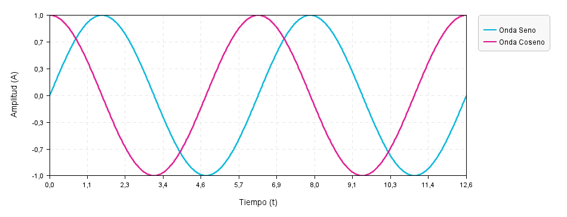

```java
package app;

import ui.Plotter;
import java.awt.Color;

public class MainSineWave {
    public static void main(String[] args) {

        Plotter p = new Plotter("Propagación de Ondas (Seno vs Coseno)", Plotter.LINE_CHART, "Tiempo (t)", "Amplitud (A)");
        p.grid(true, true);
        // Onda Seno (Azul Cyan)
        p.create(new Color(0, 180, 216), "name", "Onda Seno", "type", "FUNCTION", "style", "SOLID");

        // Onda Coseno (Rosa Magenta)
        p.create(new Color(220, 20, 140), "name", "Onda Coseno", "type", "FUNCTION", "style", "SOLID");

        // Línea base del eje X (Gris punteado)
        p.create(new Color(150, 150, 150), "name", "Reposo", "type", "FUNCTION", "style", "DASHED");

        // Rango de 0 a 4 Pi (Dos ciclos completos)
        double endX = 4 * Math.PI;

        // Le damos 1500 pasos para una resolución perfecta de la curva
        p.add("Onda Seno", 0.0, endX, 1500, x -> Math.sin(x));
        p.add("Onda Coseno", 0.0, endX, 1500, x -> Math.cos(x));
        p.add("Reposo", 0.0, endX, 100, x -> 0.0);
        p.plot();
        p.img(1920, 1080, "./etc/13_sine_waves.png");
    }
}
```

---

## Pie chart

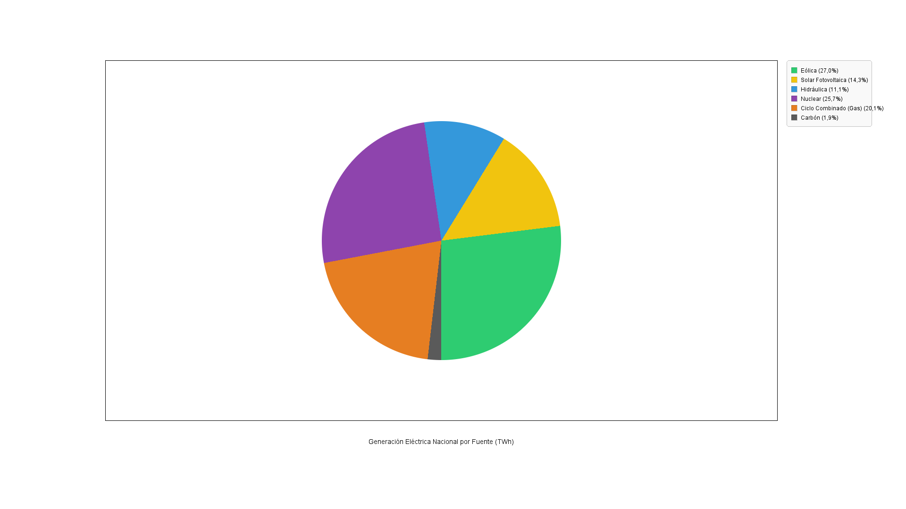

```java
package app;

import ui.Plotter;
import java.awt.Color;

public class MainPieEnergyMix {
    public static void main(String[] args) {

        Plotter p = new Plotter("Generación Eléctrica Nacional por Fuente (TWh)", Plotter.PIE_CHART, "", "");
        p.grid(false, false);

        // Energías Renovables (Tonos fríos y verdes)
        p.create(new Color(46, 204, 113), "name", "Eólica", "type", "PIE");
        p.create(new Color(241, 196, 15), "name", "Solar Fotovoltaica", "type", "PIE");
        p.create(new Color(52, 152, 219), "name", "Hidráulica", "type", "PIE");

        // Energías Base / No Renovables (Tonos cálidos y neutros)
        p.create(new Color(33, 21, 128), "name", "Nuclear", "type", "PIE");
        p.create(new Color(205, 120, 183), "name", "Ciclo Combinado (Gas)", "type", "PIE");
        p.create(new Color(243, 76, 43), "name", "Carbón", "type", "PIE");

        // Valores absolutos (Teravatios-hora). El gráfico los convierte a 360 grados.
        p.add("Eólica", "Generación", 61.2);
        p.add("Nuclear", "Generación", 58.3);
        p.add("Ciclo Combinado (Gas)", "Generación", 45.7);
        p.add("Solar Fotovoltaica", "Generación", 32.4);
        p.add("Hidráulica", "Generación", 25.1);
        p.add("Carbón", "Generación", 4.2);
        p.plot();
        p.img(1920, 1080, "./etc/16_pie_energy_mix.png");
    }
}
```

---

## Polyline plots

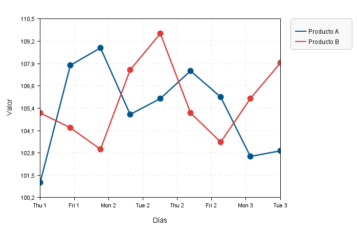

```java
package app;

import ui.Plotter;
import java.awt.Color;

public class MainPolyline {

    public static void main(String[] args) {
        // 1. Inicializamos la fachada
        Plotter p = new Plotter("Comparativa de Evolución", Plotter.POLYLINE_PLOT, "Días", "Valor");

        // Fondo gris claro
        p.setBackground(new Color(235, 236, 240));

        // ==========================================
        // SERIE 1: AZUL (Producto A)
        // ==========================================
        p.create(new Color(0, 85, 140), "name", "Producto A", "marker", "CIRCLE");

        p.add("Producto A", "Thu 1", 100.2);
        p.add("Producto A", "Fri 1", 108.3);
        p.add("Producto A", "Mon 2", 109.5);
        p.add("Producto A", "Tue 2", 104.9);
        p.add("Producto A", "Wed 2", 106.0);
        p.add("Producto A", "Thu 2", 107.9);
        p.add("Producto A", "Fri 2", 106.1);
        p.add("Producto A", "Mon 3", 102.0);
        p.add("Producto A", "Tue 3", 102.4);

        // ==========================================
        // SERIE 2: ROJA (Producto B)
        // ==========================================
        // Usamos un rojo corporativo/suave para mantener la estética
        p.create(new Color(220, 60, 60), "name", "Producto B", "marker", "CIRCLE");

        p.add("Producto B", "Thu 1", 105.0);
        p.add("Producto B", "Fri 1", 104.0);
        p.add("Producto B", "Mon 2", 102.5); // Intersección (cae por debajo del azul)
        p.add("Producto B", "Tue 2", 108.0); // Intersección (sube por encima)
        p.add("Producto B", "Wed 2", 110.5);
        p.add("Producto B", "Thu 2", 105.0);
        p.add("Producto B", "Fri 2", 103.0);
        p.add("Producto B", "Mon 3", 106.0);
        p.add("Producto B", "Tue 3", 108.5);

        // 4. Renderizado final
        p.plot();
        p.img(1920, 1080, "./etc/25_polyline.png");
    }
}
```

---

## Stacked bar plots

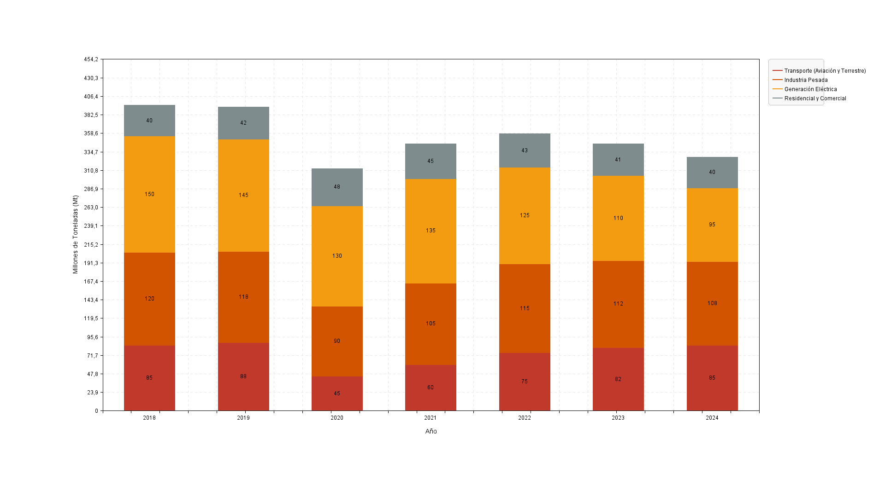

```java
package app;

import ui.Plotter;
import java.awt.Color;

public class MainStackedEmissions {
    public static void main(String[] args) {

        Plotter p = new Plotter("Evolución de Emisiones de CO2 por Sector", Plotter.STACKED_BAR_CHART, "Año", "Millones de Toneladas (Mt)");
        p.grid(true, true);

        // Paleta de colores cálidos a oscuros para representar contaminación/emisiones
        p.create(new Color(192, 57, 43), "name", "Transporte (Aviación y Terrestre)", "type", "BAR");
        p.create(new Color(211, 84, 0), "name", "Industria Pesada", "type", "BAR");
        p.create(new Color(243, 156, 18), "name", "Generación Eléctrica", "type", "BAR");
        p.create(new Color(127, 140, 141), "name", "Residencial y Comercial", "type", "BAR");

        String[] years = {"2018", "2019", "2020", "2021", "2022", "2023", "2024"};

        // Simulamos el "Efecto COVID" en 2020 (caída drástica) y la recuperación posterior
        double[] transporte = {85, 88, 45, 60, 75, 82, 85};
        double[] industria =  {120, 118, 90, 105, 115, 112, 108};
        double[] electrica =  {150, 145, 130, 135, 125, 110, 95}; // Tendencia a la baja real por renovables
        double[] residencial ={40, 42, 48, 45, 43, 41, 40}; // Subida en 2020 por trabajo remoto

        for (int i = 0; i < years.length; i++) {
            // El orden en que añades los datos determinará qué color va abajo y cuál arriba
            p.add("Generación Eléctrica", years[i], electrica[i]);
            p.add("Industria Pesada", years[i], industria[i]);
            p.add("Transporte (Aviación y Terrestre)", years[i], transporte[i]);
            p.add("Residencial y Comercial", years[i], residencial[i]);
        }
        p.plot();
        p.img(1920, 1080, "./etc/20_stacked_emissions.png");
    }
}
```
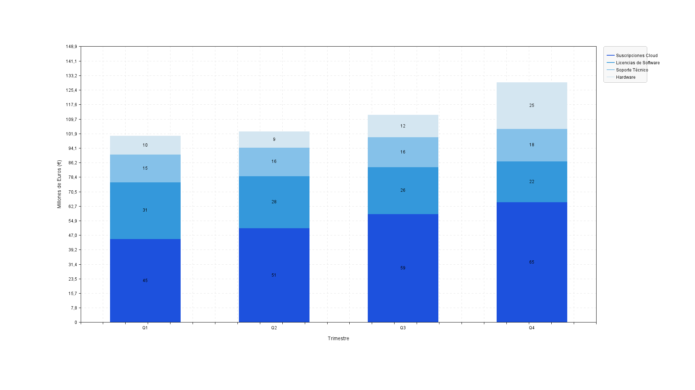

```java
package app;

import ui.Plotter;
import java.awt.Color;

public class MainStackedSales {
    public static void main(String[] args) {

        Plotter p = new Plotter("Ingresos Trimestrales por Línea de Producto (FY-2024)", Plotter.STACKED_BAR_CHART, "Trimestre", "Millones de Euros (€)");
        p.grid(true, true);

        // Usamos una paleta análoga de azules para mantener la seriedad corporativa
        p.create(new Color(29, 81, 221), "name", "Suscripciones Cloud", "type", "BAR");
        p.create(new Color(52, 152, 219), "name", "Licencias de Software", "type", "BAR");
        p.create(new Color(133, 193, 233), "name", "Soporte Técnico", "type", "BAR");
        p.create(new Color(212, 230, 241), "name", "Hardware", "type", "BAR");

        String[] quarters = {"Q1", "Q2", "Q3", "Q4"};

        // Datos simulados (Se apilarán uno encima de otro en el renderizado)
        double[] cloud = {45.2, 51.0, 58.5, 65.0};
        double[] software = {30.5, 28.0, 25.5, 22.0};
        double[] support = {15.0, 15.5, 16.0, 17.5};
        double[] hardware = {10.0, 8.5, 12.0, 25.0}; // Pico en Q4 por ventas de fin de año

        for (int i = 0; i < quarters.length; i++) {
            p.add("Suscripciones Cloud", quarters[i], cloud[i]);
            p.add("Licencias de Software", quarters[i], software[i]);
            p.add("Soporte Técnico", quarters[i], support[i]);
            p.add("Hardware", quarters[i], hardware[i]);
        }
        p.plot();
        p.img(1920, 1080, "./etc/18_stacked_sales.png");
    }
}
```

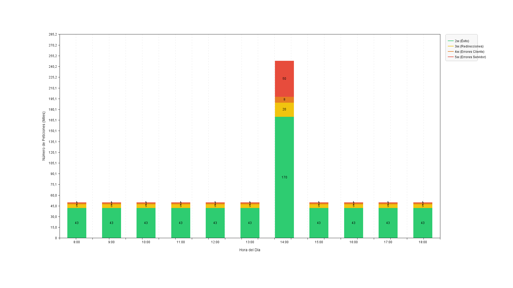

```java
package app;

import ui.Plotter;
import java.awt.Color;

public class MainStackedTraffic {
    public static void main(String[] args) {

        Plotter p = new Plotter("Monitorización de Peticiones HTTP (Últimas 24h)", Plotter.STACKED_BAR_CHART, "Hora del Día", "Número de Peticiones (Miles)");
        p.grid(false, true);

        // Los colores tienen significado semántico (Verde = OK, Amarillo = Aviso, Rojo = Error)
        p.create(new Color(46, 204, 113), "name", "2xx (Éxito)", "type", "BAR");
        p.create(new Color(241, 196, 15), "name", "3xx (Redirecciones)", "type", "BAR");
        p.create(new Color(230, 126, 34), "name", "4xx (Errores Cliente)", "type", "BAR");
        p.create(new Color(231, 76, 60), "name", "5xx (Errores Servidor)", "type", "BAR");

        // Simulamos un pico de tráfico a las 14:00 con caída de servidor (aumento de 5xx)
        for (int hora = 8; hora <= 18; hora++) {
            String timeLabel = hora + ":00";

            // Tráfico base normal
            double baseTraffic = 50 + (hora == 14 ? 150 : 0); // Pico a las 14:00

            p.add("2xx (Éxito)", timeLabel, baseTraffic * 0.85);
            p.add("3xx (Redirecciones)", timeLabel, baseTraffic * 0.10);
            p.add("4xx (Errores Cliente)", timeLabel, baseTraffic * 0.04);

            // Si es la hora pico, los errores de servidor se disparan
            double serverErrors = (hora == 14) ? baseTraffic * 0.25 : baseTraffic * 0.01;
            p.add("5xx (Errores Servidor)", timeLabel, serverErrors);
        }
        p.plot();
        p.img(1920, 1080, "./etc/19_stacked_server_traffic.png");
    }
}
```

---

## 3. Stem plot

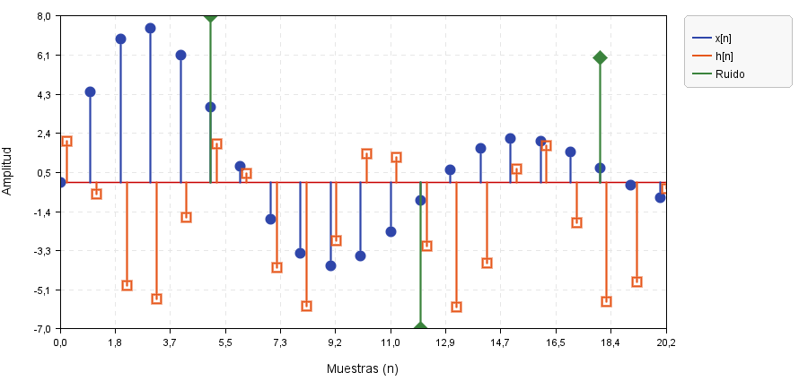

```java
package app;

import ui.Plotter;
import java.awt.Color;

public class MainStem {

    public static void main(String[] args) {
        // 1. Inicialización de la fachada
        Plotter p = new Plotter("Análisis de Señales Discretas (FIR)", Plotter.STEM_PLOT, "Muestras (n)", "Amplitud");

        // Configuramos un fondo oscuro para resaltar el Anti-Aliasing y los colores
        p.setBackground(new Color(25, 25, 30));

        // ==========================================
        // SEÑAL 1: Seno amortiguado (Círculos Macizos)
        // ==========================================
        // Usamos el varargs para configurar nombre y estilo directamente
        p.create(new Color(47, 70, 170), "name", "x[n]", "style", "CIRCLE_SOLID");

        for (int n = 0; n <= 20; n++) {
            double amplitud = Math.sin(n * 0.5) * Math.exp(-n * 0.1) * 10;
            p.add("x[n]", n, amplitud);
        }

        // ==========================================
        // SEÑAL 2: Coseno de alta frecuencia (Cuadrados Huecos)
        // ==========================================
        p.create(new Color(230, 87, 27), "name", "h[n]", "style", "SQUARE_HOLLOW");

        for (int n = 0; n <= 20; n++) {
            double amplitud = Math.cos(n * 1.2) * 4 - 2;
            p.add("h[n]", n + 0.2, amplitud); // Desplazamos un poco en X para evitar colisión exacta
        }

        // ==========================================
        // SEÑAL 3: Impulsos aislados (Rombos/Diamantes)
        // ==========================================
        p.create(new Color(58, 131, 60), "name", "Ruido", "style", "LOZENGE_SOLID");

        p.add("Ruido", 5, 8);
        p.add("Ruido", 12, -7);
        p.add("Ruido", 18, 6);

        // ==========================================
        // RENDERIZADO FINAL
        // ==========================================
        p.plot();

        p.img(1920, 1080, "./etc/24_stem.png");
    }
}
```

---

## Step plot

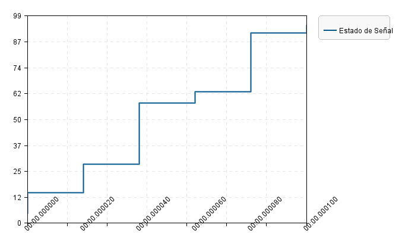

```java
package app;

import ui.Plotter;
import java.awt.Color;

public class MainStep {

    public static void main(String[] args) {
        Plotter p = new Plotter("Epoch: 1970-01-01T00:00:00", Plotter.STEP_PLOT, "", "");

        p.create(new Color(0, 85, 140), "name", "Estado de Señal");

        // Fíjate cómo la gráfica de la imagen empieza en Y=0 y sube a Y=10 en el origen.
        // Para lograr eso con un Step Plot, introducimos un punto inicial y luego el salto.
        p.add("Estado de Señal", "00:00.000000", 0.0);
        p.add("Estado de Señal", "00:00.000000", 11.0);

        // Los siguientes saltos ocurren en los distintos timestamps
        p.add("Estado de Señal", "00:00.000020", 26.0);
        p.add("Estado de Señal", "00:00.000040", 58.0);
        p.add("Estado de Señal", "00:00.000060", 64.0);
        p.add("Estado de Señal", "00:00.000080", 95.0);
        p.add("Estado de Señal", "00:00.000100", 99.0);

        p.plot();
        p.img(1920, 1080, "./etc/23_step.png");
    }
}
```
