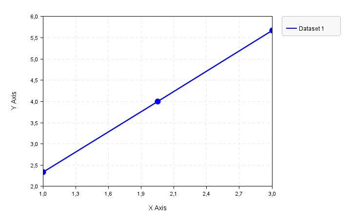
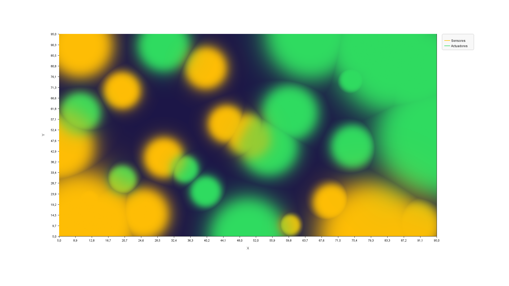
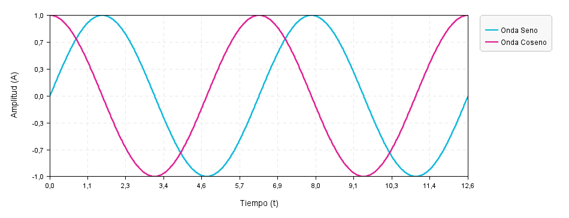
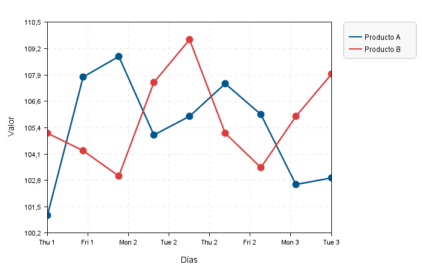

# JPlot
A lightweight Java charting library inspired by Matplotlib. Single-JAR import and minimal code to set up charts. Easy-to-interpret visualizations. Extremely lightweight with hassle-free installation, yet packed with deep customization options so your charts look exactly the way you want. Clean architecture and intuitive facade. Designed from the ground up to be fully friendly to AI agents and automated code generation workflows, allowing large language models to write, reason about, and execute plotting scripts effortlessly without complex boilerplate.

---

## Key Features

* **Single-JAR Architecture:** Completely lightweight design with zero heavy external dependencies for effortless project integration.
* **Advanced SDF Rendering:** Custom mathematical engine featuring Signed Distance Fields anti-aliasing for ultra-smooth lines, heatmaps, and discrete stem plots.
* **AI-Friendly Design:** Intuitive Facade pattern (`Plotter`) and modular structure optimized for seamless automated code generation and interaction with large language models.
* **Flexible Output:** Display charts instantly in interactive Swing JFrame windows or export them cleanly as image files.
---

## Installation

Download the latest release JAR file and add it to your project's libraries or classpath.

---
## Quick Start

Initialize the chart using the intuitive `Plotter` facade, add your data points, and render the visualization instantly with minimal code.


```java
import ui.Plotter;
import java.awt.Color;

public class Main {
    public static void main(String[] args) {
        Plotter plotter = new Plotter("Simple Chart", Plotter.POLYLINE_PLOT, "X Axis", "Y Axis");
        plotter.create(Color.BLUE, "name", "Dataset 1");
        plotter.add("Dataset 1", 1.0, 2.0);
        plotter.add("Dataset 1", 2.0, 4.0);
        plotter.add("Dataset 1", 3.0, 6.0);
        plotter.plot();
    }
}
```

## More Visualization Examples

Here are examples of different plot types rendered with the library:




## Documentation & Examples

For more advanced use cases, custom configurations, and detailed guides, check out the following resources:

* [Full Documentation (DOC.md)](DOC.md)
* [Code Examples (EXAMPLES.md)](EXAMPLES.md)

---

## Project Structure

The project is organized into modular packages, cleanly separating core abstractions, specific chart implementations, UI components, and application examples:

* `app/`: Executable examples, benchmarks, and demo applications showcasing the wide variety of supported chart types.
* Chart Modules (`bar`, `bubble`, `confusion`, `hbar`, `heatmap`, `histogram`, `line`, `pie`, `polyline`, `stackedbar`, `stem`, `step`): Dedicated packages for each visualization type, containing their respective configurations, datasets, series, points, and custom renderers.
* `model/`: Core data structures and base classes shared across the library (`Config`, `Dataset`, `Point`, `Series`, `Pixel`).
* `multi/`: Utilities and controllers for managing multi-plot layouts (`MultiPlotter`).
* `ui/`: Swing-based graphical interface components (`ChartFrame`, `ChartPanel`, `LoadingPanel`) and the primary `Plotter` facade.
---

## Contributing

Contributions are welcome! If you would like to contribute, please follow these steps:

1. Fork the repository.
2. Create a new feature branch (`git checkout -b feature/AmazingFeature`).
3. Commit your changes (`git commit -m 'Add some AmazingFeature'`).
4. Push to the branch (`git push origin feature/AmazingFeature`).
5. Open a Pull Request.

For major changes or bug reports, please open an issue first to discuss what you would like to change.

---

## License

This project is distributed under the terms of the MIT License. See the [License File](LICENSE) for more details.
